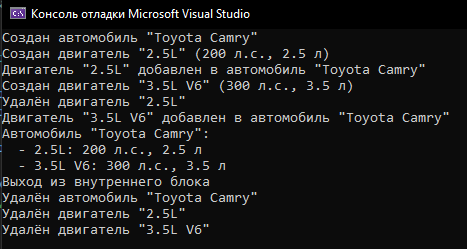
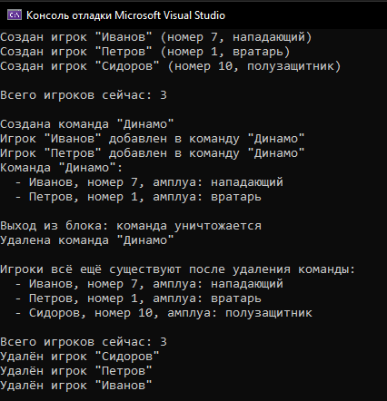
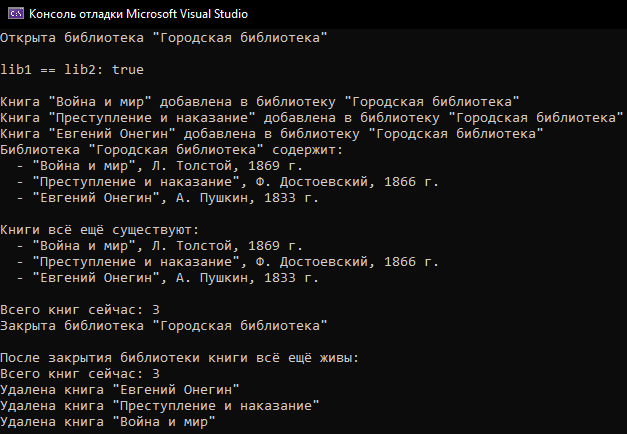

# Лабораторная работа №1: Отношения между классами в C++

**Студент:** Ануфриев Владислав Денисович  
**Группа:** ПИЖ-б-о-25-2  
**Вариант:** 2  
**Уровень:** Базовый, средний, продвинутый  
**Технология:** C++17

## Цель работы

Научиться проектировать отношения между классами: композицию, агрегацию и ассоциацию. Освоить реализацию композиции (поля-объекты, вложение структур) и агрегации (указатели, ссылки). Понять разницу между композицией и агрегацией с точки зрения времени жизни объектов. Научиться использовать статические поля и методы для подсчёта объектов и реализации общих данных для всех экземпляров класса. Получить навыки правильного управления памятью при разных типах отношений между классами. Дополнительно: освоить паттерн проектирования «Одиночка» (Singleton).


## Базовый уровень. Композиция: `Car` и `Engine`

**Файлы:** `basic/car.h`, `basic/car.cpp`, `basic/main.cpp`

**Задание:** Реализовать два класса, связанных отношением композиция (часть не может существовать без целого).

**Реализация:**

- Класс `Engine` — часть. Хранит название, мощность, объём.
- Класс `Car` — целое. Хранит модель и `std::vector<Engine>`.
- Двигатели создаются внутри автомобиля через `emplace_back` и уничтожаются вместе с ним.

**Сборка и запуск:**

```bash
cd basic
g++ -std=c++17 main.cpp car.cpp -o car
./car
```

**Результат:**



---

## Средний уровень. Агрегация: `Team` и `Player`

**Файлы:** `medium/team.h`, `medium/team.cpp`, `medium/main.cpp`

**Задание:** Реализовать два класса, связанных отношением агрегация (часть может существовать без целого). Добавить статическое поле для подсчёта количества объектов класса «Часть». Продемонстрировать, что при уничтожении целого части продолжают существовать.

**Реализация:**

- Класс `Player` — часть. Хранит имя, номер, амплуа. Есть статическое поле `playerCount` и статический метод `getPlayerCount()`.
- Класс `Team` — целое. Хранит `std::vector<Player*>` — указатели, а не копии.
- В деструкторе `Team` игроки **не удаляются**.
- В `main` команда создана внутри блока `{ ... }`, поэтому уничтожается раньше игроков.
- Есть проверка на `nullptr` в `addPlayer`.

**Сборка и запуск:**

```bash
cd medium
g++ -std=c++17 main.cpp team.cpp -o team
./team
```

**Результат:**



---

## Продвинутый уровень. Singleton + агрегация: `Library` и `Book`

**Файлы:** `advanced/library.h`, `advanced/library.cpp`, `advanced/main.cpp`

**Задание:** Реализовать отношение агрегация, добавить статическое поле для подсчёта объектов одного из классов, реализовать паттерн «Одиночка» (Singleton) для одного из классов, продемонстрировать работу всех реализованных возможностей.

**Реализация:**

- Класс `Book` — часть. Хранит название, автора, год. Есть статическое поле `bookCount` и статический метод `getBookCount()`.
- Класс `Library` — целое, реализован как **Singleton**:
  - приватный конструктор и деструктор;
  - статическое поле `instance`;
  - статический метод `getInstance()`;
  - удалены конструктор копирования и оператор присваивания (`= delete`);
  - есть статический метод `destroyInstance()` для освобождения памяти через `delete`.
- Между `Library` и `Book` — **агрегация**: библиотека хранит `std::vector<Book*>`, книги создаются отдельно в `main` и не удаляются вместе с библиотекой.
- Есть проверка на `nullptr` в `addBook`.
- В `main` продемонстрировано:
  - что `getInstance()` возвращает один и тот же объект (`lib1 == lib2`);
  - что после `destroyInstance()` книги продолжают существовать, а счётчик `bookCount` остаётся равен 3.

**Сборка и запуск:**

```bash
cd advanced
g++ -std=c++17 main.cpp library.cpp -o library
./library
```

**Результат:**



---

## Используемые технологии

- Язык: C++17
- Компилятор: g++
- Управление памятью: стек, куча (`new` / `delete`), указатели, `std::vector`
- Паттерны: Singleton
- Отношения между классами: композиция, агрегация

---

## Выводы

В ходе лабораторной работы были изучены и практически реализованы три типа отношений между классами: композиция, агрегация и ассоциация. Освоены различия между ними с точки зрения времени жизни объектов и управления памятью. Реализованы статические поля и методы для подсчёта объектов класса. Изучен и применён паттерн «Одиночка» (Singleton). Получены навыки корректного управления памятью при разных типах отношений: части, созданные по значению, уничтожаются вместе с целым, а части, хранимые по указателям, продолжают существовать независимо.